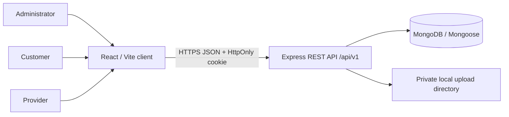

# Architecture

The client calls an Axios instance with `withCredentials`. Express restricts CORS to `CLIENT_URL`, applies Helmet, JSON size limits, rate limiting and centralized errors. Mongoose documents own persistence; route handlers enforce role and record ownership. Password hashes are excluded from ordinary queries. The JWT carries subject and role, but each request reloads the user and checks active status.

## Boundaries

- Public registration accepts customer/provider only. Admin is provisioned through controlled database operations/seed only.
- Provider discovery filters to approved providers with active user accounts. Public provider serializers do not include verification documents.
- Document upload accepts PDF/JPEG/PNG with configured size cap; file paths are server-side and the admin document route checks role. Local folder is not production object storage.
- Customer booking reads are scoped to owner; providers to their provider record; admin may inspect all bookings. Booking mutations enforce role-specific transitions.
- Notifications are created in MongoDB and queried by recipient.
- Address details are returned only with bookings to authorized participants/admin. Public profile contains city/locality only.

## Deployment

Host the static `client/dist` on Vercel/Netlify and the Node server on Render/AWS or comparable services. Use Atlas or managed MongoDB. Configure exact frontend origin, HTTPS, secure cookies, strong JWT secret, persistent private document storage, backup/retention policy and monitoring. Cross-site cookie deployments may require `SameSite=None; Secure` plus strict CSRF/origin controls; current default is `Lax` and needs environment-aware production review.
